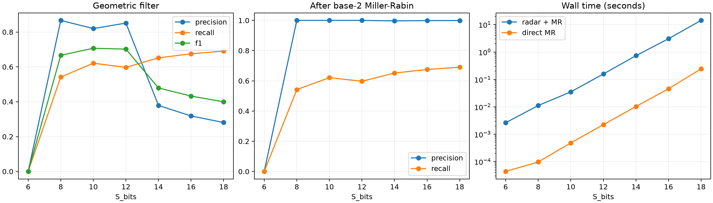

# OMEGAGRAD

[Leia em Português (pt-BR)](docs/pt-BR/README.pt-BR.md)

**A Differentiable Top-Down Framework for Cosmological Finite Arithmetic**

**Richard Ikeda — Author & Lead Investigator**
Version **1.0.0**, Final Archival Release · November 6, 2026 · MIT License

OMEGAGRAD is an experimental mathematics and scientific computing study of finite prime sets represented by differentiable potentials. A finite horizon is normalized to one, allowing potential wells, separating barriers, basin widths, and harmonic-wave candidate detectors to be compared across scales.

The cosmological terminology motivates a finite operational horizon. The implemented cutoff is the largest prime not exceeding `2**S_bits`; it does not calculate a physical cosmological bound or Kolmogorov complexity.

## Study overview

| Phase | Scope | Principal observation |
|---|---|---|
| 1 | 6–12 bits; scalar autograd; potential geometry | Fixed smoothing lost wells; inverse-square smoothing preserved one well per prime in the tested configurations. |
| 2 | 6–12 bits; continuum detrending; reduced-base wave; removal test | Detrending improved mean absolute error, but the joint two-feature regression retained negative test R². Blind-wave candidates had high recall and many false positives. |
| 3 | Radar through 18 bits; geometry through 16 bits; tensor derivatives | A three-feature retrospective regression reached R²=0.1841 at 16 bits. Geometric filtering improved precision at the expense of recall; the hybrid pipeline remained slower than direct base-2 Miller–Rabin. |



At 12 bits, the complete potential has 564 known primes but only 74 minima with fixed epsilon. Inverse-square smoothing retained all 564 minima. The phase-3 radar reduced false positives from the phase-2 count of 2,211 to 57, while recall fell to 59.71%. That comparison changes both phase restrictions and filtering; it does not isolate well depth alone.

Positive regression scores are retrospective: the complete potential contains the target primes. Reduced-base radar evaluation is separate from that full-oracle geometry. A single Miller–Rabin base is not a primality certificate.

## Install and reproduce

Python 3.10 or newer; the reference experiments used Python 3.12. Create and activate a virtual environment, then:

```bash
python -m pip install -e ".[test,report]"
python -m pytest -q
python -m examples.scalar_optimization
python -m examples.tensor_derivatives
python -m examples.background_subtraction
python -m examples.stationary_landscape
```

The published datasets are already included. To rerun the experiments:

```bash
python -m omegagrad.experiments --output outputs/reproduction_phase1
python -m omegagrad.phase2
python -m omegagrad.phase3
python -m omegagrad.phase3_refine
python build_technical_papers.py
```

Phase 2 and Phase 3 runners write to their fixed output directories and replace existing files. Use a separate clone for reproduction. The full phase-3 geometry is computationally intensive; CI runs numerical tests and reuse examples rather than all experiments. Historical results identify their execution versions and hashes; archival documentation changes do not redefine those runs.

## Reuse the numerical components

```python
from omegagrad.engine import Value
x = Value(2.0)
loss = (x - 3.0)**2
loss.backward()
print(x.grad)  # -2.0
```

`Value` provides scalar first-order reverse differentiation. `TensorValue` adds NumPy broadcasting, reverse differentiation, and forward directional second derivatives; independent coordinate batches yield local second derivatives. It does not provide a dense general Hessian. See the [reuse guide](docs/en/REUSE_GUIDE.md) and [executable examples](examples/README.md).

## Documentation and research artifacts

- [Technical paper](docs/en/PAPER.md) · [English PDF](output/pdf/OMEGAGRAD_Technical_Paper.pdf)
- [Theory](docs/en/THEORY.md) · [Methodology](docs/en/METHODOLOGY.md) · [Findings](docs/en/FINDINGS.md)
- [Reproducibility](docs/en/REPRODUCIBILITY.md) · [Data dictionary](docs/en/DATA_DICTIONARY.md)
- [Complete Portuguese archive](docs/pt-BR/ARCHIVE.md)
- [Phase 1 data](outputs/first_run/results.json) · [Phase 2 data](outputs/phase2/results.json) · [Phase 3 data](outputs/phase3/results.json)
- [Citation metadata](CITATION.cff) · [License](LICENSE) · [Contributing](CONTRIBUTING.md)

## Archival scope

This release consolidates the completed experiments, their limitations, bilingual documentation, and reusable numerical components. It does not claim a new theorem about primes, a certified blind sieve, or a computational advantage over discrete primality testing. “Archival” describes this release; the GitHub repository remains writable for reproducibility corrections.
