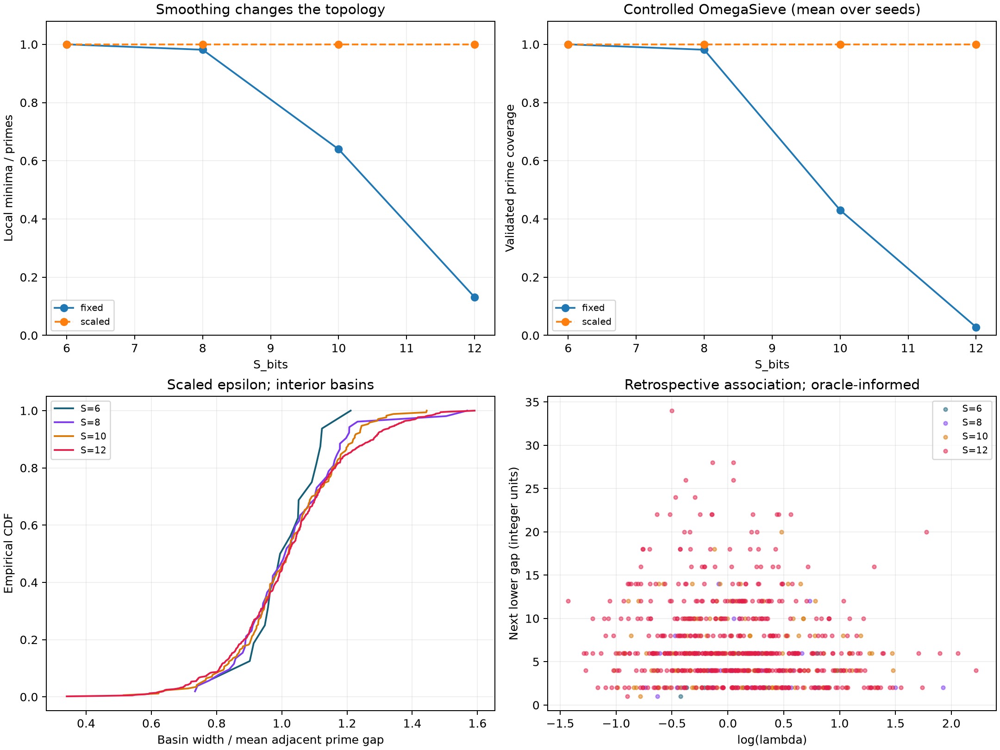
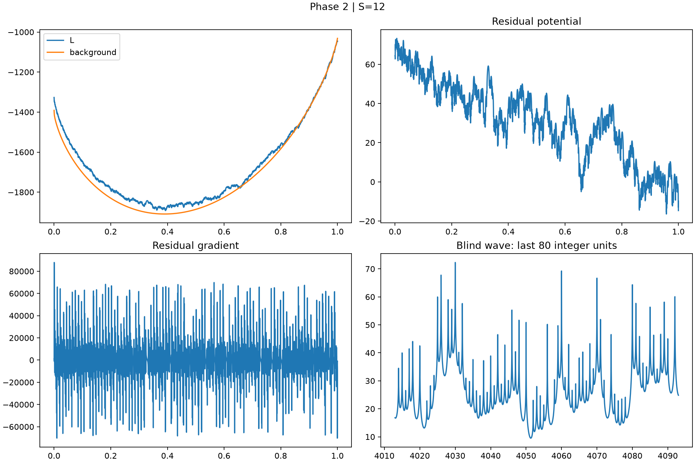
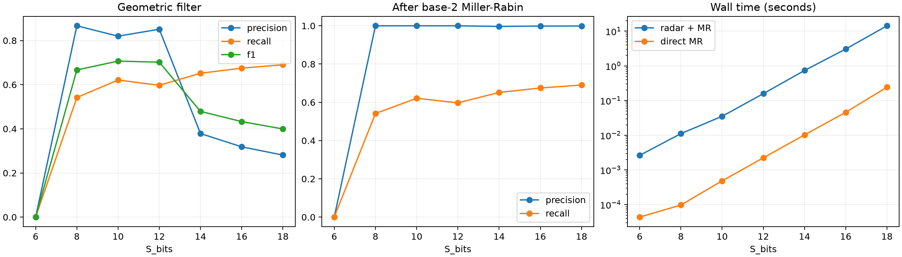

# OMEGAGRAD: A Differentiable Top-Down Framework for Cosmological Finite Arithmetic

**Richard Ikeda — Author & Lead Investigator**

Technical report · Final archival release 1.0.0 · November 6, 2026

## Abstract

We study finite prime sets normalized to (0,1] using differentiable logarithmic potentials and reduced-base harmonic waves. Inverse-square regularization preserved local wells over 6–12 bits. Background subtraction and barrier displacement yielded positive retrospective test R² through 16 bits. A wave radar reached 18 bits, with a precision–recall trade-off and higher runtime than direct base-2 Miller–Rabin. The results delimit when continuous geometry supports description and when discrete verification dominates computation.

## 1. Hypotheses

H1 tests whether local attractors survive expansion of the normalized horizon. H2 tests whether residual asymmetry, curvature and barrier displacement explain the next lower prime gap. H3 tests whether wave minima formed from primes up to the square root of the horizon can recover the larger primes accurately and economically.

## 2. Model and protocol

The horizon P is the largest prime at most 2**S_bits. Cosmological terminology motivates a finite operational cutoff. The implementation uses this representational bound throughout. With d=z-p/P, the smoothed potential L sums log(d²+epsilon). Its gradient sums 2d/(d²+epsilon) and its Hessian sums 2(epsilon-d²)/(d²+epsilon)². The contribution of other terms shifts minima away from exact prime positions. Local maxima bound deterministic one-dimensional attraction basins.

Phase 1 compares epsilon=1e-6 and epsilon=1e-6*(61/P)² in 6, 8, 10 and 12 bits. The latter fixes the smoothing width in integer units at 0.061. Seeds 0, 1 and 2 yield 24 trajectories. Navigation uses momentum, relative noise and controlled leftward escape. Stationary roots are located by sign-change brackets, Brent and safeguarded Newton polishing. Mesh refinement tests stability. Tangent roots may evade sign-change detection.

Phase 2 subtracts the integral of the same log kernel against P/log(uP) over [2/P,1]. Quadrature and spline interpolation approximate this background. A matched-interval ablation compares the original and residual fields using log(lambda) and log(abs(H)), where lambda is the ratio of left to right distances to the barrier and H is its Hessian. The target is the next lower gap. The spatial split trains on the upper 70%, skips one row, and evaluates on the lower region. Phase 3 adds barrier displacement in integer units and uses batched bisection at 12, 14 and 16 bits. Its refined background uses 4097 global knots, edge refinement and split quadrature.

The reduced-base wave sums -log(sin²(pi*x/p)+epsilon). The Phase 2 scanner rounds continuous minima without modular screening. The Phase 3 radar excludes 2 and 3 from the sum and searches cells centered on 6k±1. Energy, curvature and fractional distance thresholds are selected by training F1 on small-base labels only. Empty calibration at 6 bits yields no candidates. Survivors receive one strong Miller–Rabin round with base 2. The evaluator retains separate ground truth. The horizon itself is supplied.

## 3. Numerical validation

The maximum measured scalar gradient discrepancy was 7.28e-11. The 2048-coordinate tensor check measured 2.05e-12 for gradients and 1.40e-9 for second derivatives. The 1e-10 threshold thus applies to the measured gradients. TensorValue propagates directional second derivatives, which give local Hessians for independent coordinates. The full-potential geometry uses the complete reference set.

## 4. Phase 1 — attractor preservation

| Bits | Horizon | Primes | Fixed minima | Scaled minima |
| --- | --- | --- | --- | --- |
| 6 | 61 | 18 | 18 | 18 |
| 8 | 251 | 54 | 53 | 54 |
| 10 | 1021 | 172 | 110 | 172 |
| 12 | 4093 | 564 | 74 | 564 |

At 12 bits, fixed epsilon leaves 74 minima for 564 primes. The scaled policy preserves all 564 wells, and controlled navigation recovers all reference primes across the three seeds. H1 receives support within the audited range. The exact dimensional identity for smoothing width and the empirical preservation result have different logical status.

## 5. Phase 2 — detrending and blind candidates

| Bits | Wave P | Wave R | Wave F1 | Residual MAE | Test R² |
| --- | --- | --- | --- | --- | --- |
| 6 | 0.3611 | 0.9286 | 0.5200 | 1.6778 | -1.7412 |
| 8 | 0.3038 | 1.0000 | 0.4660 | 1.9832 | -0.9590 |
| 10 | 0.2355 | 0.9814 | 0.3798 | 2.7106 | -0.1737 |
| 12 | 0.1951 | 0.9817 | 0.3255 | 3.0214 | -0.0435 |

Detrending improves MAE over the training mean in all tested scales, while test R² remains negative with two features. At 12 bits the scanner returns 536 true positives, 2211 false positives and 10 false negatives. A seed-42 removal experiment hides about 10% of internal primes and measures local shifts and Hessians. The retained-gap midpoint heuristic recovers zero hidden coordinates exactly.

## 6. Phase 3 — filtering and cost

| Bits | Filter P | Filter R | Filter F1 | Hybrid P | Hybrid R |
| --- | --- | --- | --- | --- | --- |
| 6 | 0.0000 | 0.0000 | 0.0000 | 0.0000 | 0.0000 |
| 8 | 0.8667 | 0.5417 | 0.6667 | 1.0000 | 0.5417 |
| 10 | 0.8197 | 0.6211 | 0.7067 | 1.0000 | 0.6211 |
| 12 | 0.8512 | 0.5971 | 0.7018 | 1.0000 | 0.5971 |
| 14 | 0.3786 | 0.6517 | 0.4790 | 0.9967 | 0.6517 |
| 16 | 0.3183 | 0.6749 | 0.4326 | 0.9986 | 0.6749 |
| 18 | 0.2810 | 0.6903 | 0.3994 | 0.9989 | 0.6903 |

| Bits | MR calls | Call reduction | Hybrid (s) | Direct (s) | Time ratio |
| --- | --- | --- | --- | --- | --- |
| 6 | 0 | 100.00% | 0.002626 | 0.000044 | 60.10 |
| 8 | 30 | 87.29% | 0.011122 | 0.000097 | 114.42 |
| 10 | 122 | 87.68% | 0.035163 | 0.000484 | 72.62 |
| 12 | 383 | 90.50% | 0.157829 | 0.002234 | 70.65 |
| 14 | 3217 | 80.21% | 0.735462 | 0.010257 | 71.70 |
| 16 | 13756 | 78.92% | 3.059476 | 0.045797 | 66.81 |
| 18 | 56263 | 78.50% | 14.272784 | 0.242789 | 58.79 |

At 12 bits the false-positive count drops from 2211 to 57 (97.42%), with recall falling from 98.17% to 59.71%. The comparison changes the base, phase restriction and thresholds together. Within-pipeline phase-locked scores in radar.json isolate the threshold step. Small-base primes cancel their own sine terms. This creates a calibration distribution shift whose individual causal effect was not isolated.

Nonempty runs save about 78.5–90.5% of calls relative to verifying every integer. Wall time is 58.8–114.4 times direct base-2 verification in the recorded runs. These are single-run timings. The empty 6-bit result saves calls by yielding no candidates. Hybrid precision is high with reduced recall. Strong pseudoprimes survive one-base verification in larger configurations.

## 7. Extended geometry

| Bits | Barriers | Missing | MAE | Baseline MAE | Test R² |
| --- | --- | --- | --- | --- | --- |
| 12 | 563 | 0 | 2.8721 | 3.4578 | 0.0398 |
| 14 | 1899 | 0 | 3.9050 | 4.5875 | 0.1216 |
| 16 | 6541 | 0 | 4.6450 | 5.4999 | 0.1841 |

| Bits A | Bits B | KS |
| --- | --- | --- |
| 12 | 14 | 0.037545 |
| 14 | 16 | 0.028529 |

Residual-basin widths are normalized by mean adjacent gap. KS distances describe empirical similarity across three finite scales with spatial dependence. The decline to 0.028529 supports descriptive stability within this protocol. The positive test R² of 0.1841 at 16 bits measures association conditional on the complete potential. Since target primes remain encoded, this experiment cannot establish target-independent prediction.

## 8. Conclusion and availability

OMEGAGRAD provides a reproducible study of the interaction between smoothing, local prime geometry and continuous candidate selection. H1 receives finite empirical support. H2 yields a retrospective geometric signal. H3 exposes the cost and recall limits of replacing discrete verification with a wave-based prefilter. The software includes reusable scalar and tensor derivatives, background subtraction and stationary landscape examples. The study establishes observations over recorded configurations and leaves asymptotic invariance and target-independent prediction open.

Source checkpoints: 2c828e8 (Phase 1), dc54a92 (Phase 2), 8579a08 (Phase 3). Cite Richard Ikeda, OMEGAGRAD v1.0.0 (2026). MIT license.

[Phase 1](../../outputs/first_run/results.json) · [Phase 2](../../outputs/phase2/results.json) · [Phase 3](../../outputs/phase3/results.json) · [Benchmarks](../../outputs/phase3/summary.csv) · [Citation](../../CITATION.cff)

## Figures

Figure 1. Topology, coverage and basin-width comparison.

Figure 2. Background, residual gradient and wave at 12 bits.

Figure 3. Radar, hybrid verification and measured runtime.
