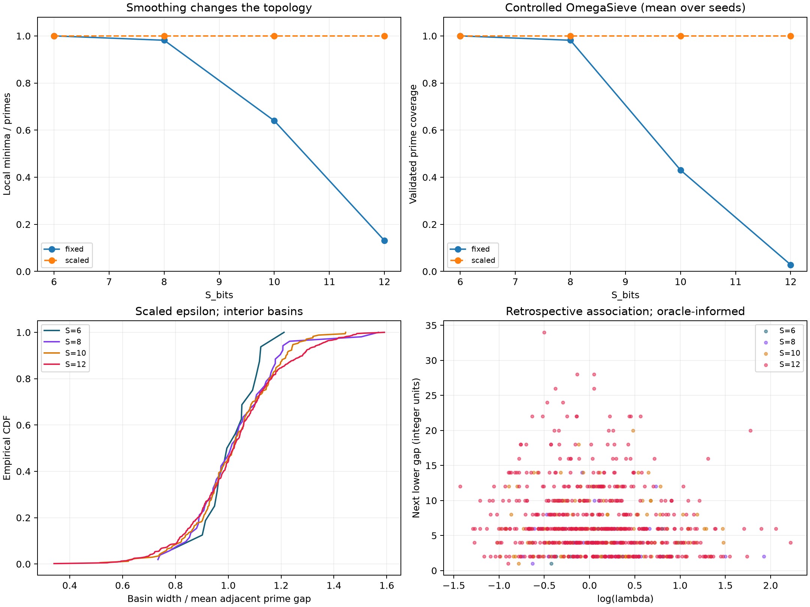
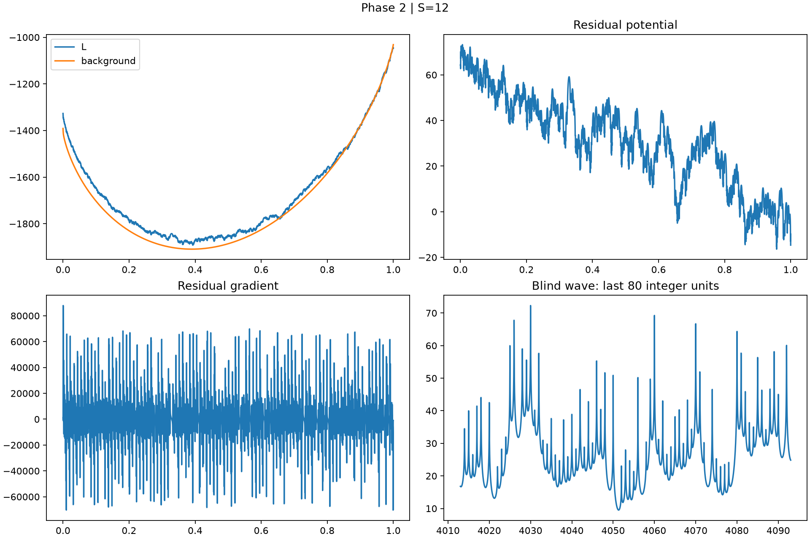
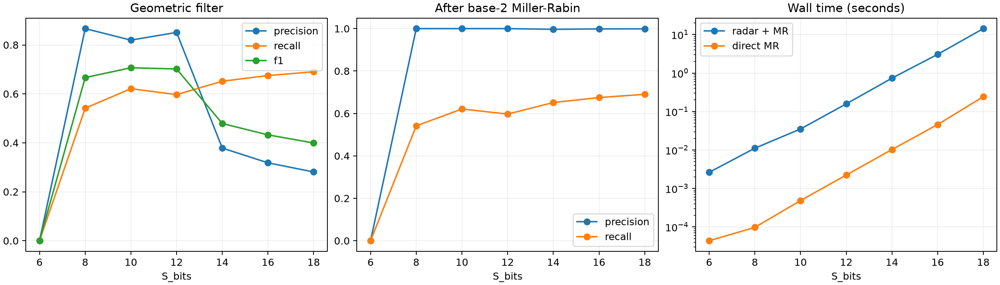

# OMEGAGRAD: A Differentiable Top-Down Framework for Cosmological Finite Arithmetic

**Richard Ikeda — Autor e Pesquisador Principal (Author & Lead Investigator)**

Relatório técnico · Versão final de arquivo 1.0.0 · 6 de novembro de 2026

## Resumo

Estudamos conjuntos finitos de primos normalizados em (0,1] por potenciais logarítmicos diferenciáveis e ondas harmônicas de base reduzida. A regularização pelo inverso do quadrado preservou poços locais de 6 a 12 bits. A subtração de fundo e o deslocamento das barreiras produziram R² retrospectivo positivo até 16 bits. O radar chegou a 18 bits, com compromisso entre precisão e recall e tempo superior ao de Miller–Rabin base 2 direto. Os resultados delimitam o alcance descritivo da geometria contínua e seu custo frente à verificação discreta.

## 1. Hipóteses

H1 testa se os atratores locais sobrevivem à expansão do horizonte normalizado. H2 testa se assimetria residual, curvatura e deslocamento da barreira explicam o próximo gap inferior. H3 testa se mínimos da onda formada pelos primos até a raiz do horizonte recuperam os primos maiores com precisão e custo competitivo.

## 2. Modelo e protocolo

O horizonte P é o maior primo até 2**S_bits. A terminologia cosmológica motiva um corte operacional finito. A implementação usa esse limite de representação. Com d=z-p/P, o potencial L soma log(d²+epsilon). Seu gradiente soma 2d/(d²+epsilon) e sua Hessiana soma 2(epsilon-d²)/(d²+epsilon)². Os demais termos deslocam os mínimos em relação às posições primas. Máximos locais delimitam as bacias determinísticas unidimensionais.

A Fase 1 compara epsilon=1e-6 e epsilon=1e-6*(61/P)² em 6, 8, 10 e 12 bits. O segundo mantém a largura de suavização em 0,061 unidade inteira. As sementes 0, 1 e 2 produzem 24 trajetórias. A navegação usa momento, ruído relativo e escape controlado à esquerda. As raízes são localizadas por mudança de sinal, Brent e polimento Newton com salvaguarda. O refinamento testa estabilidade. Raízes tangentes podem escapar à detecção.

A Fase 2 subtrai o integral do mesmo núcleo logarítmico contra P/log(uP) em [2/P,1]. Quadratura e spline aproximam o fundo. Uma ablação com intervalos pareados compara os campos original e residual usando log(lambda) e log(abs(H)), onde lambda é a razão entre as distâncias esquerda e direita à barreira e H é sua Hessiana. O alvo é o próximo gap inferior. O treino usa os 70% superiores, omite uma linha e testa na região inferior. A Fase 3 acrescenta o deslocamento da barreira em unidades inteiras e usa bisseção em lote em 12, 14 e 16 bits. Seu fundo refinado usa 4097 nós globais, amostras nas bordas e quadratura subdividida.

A onda de base reduzida soma -log(sin²(pi*x/p)+epsilon). O scanner da Fase 2 arredonda mínimos contínuos sem filtragem modular. O radar da Fase 3 exclui 2 e 3 da soma e examina células centradas em 6k±1. Os limiares de energia, curvatura e distância fracionária são escolhidos por F1 apenas nos rótulos da base pequena. A calibração vazia em 6 bits deixa a saída vazia. Os sobreviventes recebem uma rodada forte de Miller–Rabin base 2. O avaliador mantém a verdade separada. O horizonte é fornecido.

## 3. Validação numérica

O maior desvio medido no gradiente escalar foi 7,28e-11. O lote de 2048 coordenadas mediu 2,05e-12 para gradientes e 1,40e-9 para derivadas segundas. O limite de 1e-10 vale, portanto, para os gradientes medidos. TensorValue propaga derivadas segundas direcionais, que fornecem Hessianas locais para coordenadas independentes. A geometria do potencial completo usa toda a base de referência.

## 4. Fase 1 — preservação dos atratores

| Bits | Horizonte | Primos | Mínimos fixos | Mínimos escalados |
| --- | --- | --- | --- | --- |
| 6 | 61 | 18 | 18 | 18 |
| 8 | 251 | 54 | 53 | 54 |
| 10 | 1021 | 172 | 110 | 172 |
| 12 | 4093 | 564 | 74 | 564 |

Em 12 bits, epsilon fixo deixa 74 mínimos para 564 primos. A política escalada preserva os 564 poços e a navegação controlada recupera toda a base nas três sementes. H1 recebe suporte no intervalo auditado. A identidade dimensional exata da largura e a preservação empírica dos poços têm estatutos lógicos distintos.

## 5. Fase 2 — detrending e candidatos cegos

| Bits | Precisão | Recall | F1 da onda | MAE residual | R² de teste |
| --- | --- | --- | --- | --- | --- |
| 6 | 0,3611 | 0,9286 | 0,5200 | 1,6778 | -1,7412 |
| 8 | 0,3038 | 1,0000 | 0,4660 | 1,9832 | -0,9590 |
| 10 | 0,2355 | 0,9814 | 0,3798 | 2,7106 | -0,1737 |
| 12 | 0,1951 | 0,9817 | 0,3255 | 3,0214 | -0,0435 |

O detrending melhora o MAE frente à média do treino em todas as escalas, mas o R² de teste permanece negativo com duas features. Em 12 bits, o scanner retorna 536 verdadeiros positivos, 2211 falsos positivos e 10 falsos negativos. O teste de remoção com semente 42 oculta cerca de 10% dos primos internos e mede deslocamentos e Hessianas. A heurística do ponto médio dos gaps retidos não recupera nenhuma coordenada oculta exatamente.

## 6. Fase 3 — filtragem e custo

| Bits | Precisão filtro | Recall filtro | F1 filtro | Precisão híbrido | Recall híbrido |
| --- | --- | --- | --- | --- | --- |
| 6 | 0,0000 | 0,0000 | 0,0000 | 0,0000 | 0,0000 |
| 8 | 0,8667 | 0,5417 | 0,6667 | 1,0000 | 0,5417 |
| 10 | 0,8197 | 0,6211 | 0,7067 | 1,0000 | 0,6211 |
| 12 | 0,8512 | 0,5971 | 0,7018 | 1,0000 | 0,5971 |
| 14 | 0,3786 | 0,6517 | 0,4790 | 0,9967 | 0,6517 |
| 16 | 0,3183 | 0,6749 | 0,4326 | 0,9986 | 0,6749 |
| 18 | 0,2810 | 0,6903 | 0,3994 | 0,9989 | 0,6903 |

| Bits | Chamadas MR | Redução | Híbrido (s) | Direto (s) | Razão de tempo |
| --- | --- | --- | --- | --- | --- |
| 6 | 0 | 100,00% | 0,002626 | 0,000044 | 60,10 |
| 8 | 30 | 87,29% | 0,011122 | 0,000097 | 114,42 |
| 10 | 122 | 87,68% | 0,035163 | 0,000484 | 72,62 |
| 12 | 383 | 90,50% | 0,157829 | 0,002234 | 70,65 |
| 14 | 3217 | 80,21% | 0,735462 | 0,010257 | 71,70 |
| 16 | 13756 | 78,92% | 3,059476 | 0,045797 | 66,81 |
| 18 | 56263 | 78,50% | 14,272784 | 0,242789 | 58,79 |

Em 12 bits, os falsos positivos caem de 2211 para 57 (97,42%), e o recall passa de 98,17% a 59,71%. A comparação altera base, restrição de fase e limiares conjuntamente. As métricas com fase fixa em radar.json isolam a etapa dos limiares. Os primos da base cancelam os próprios senos. Isso cria uma mudança de distribuição cujo efeito causal individual não foi isolado.

As execuções não vazias poupam cerca de 78,5–90,5% das chamadas em relação à verificação de todos os inteiros. O tempo total é 58,8–114,4 vezes o da verificação base 2 direta nos registros. São tempos de execuções individuais. Em 6 bits, a economia corresponde à saída vazia. O híbrido tem precisão elevada com recall reduzido. Pseudoprimos fortes sobrevivem à verificação de uma base nas configurações maiores.

## 7. Geometria estendida

| Bits | Barreiras | Ausentes | MAE | MAE de referência | R² de teste |
| --- | --- | --- | --- | --- | --- |
| 12 | 563 | 0 | 2,8721 | 3,4578 | 0,0398 |
| 14 | 1899 | 0 | 3,9050 | 4,5875 | 0,1216 |
| 16 | 6541 | 0 | 4,6450 | 5,4999 | 0,1841 |

| Bits A | Bits B | KS |
| --- | --- | --- |
| 12 | 14 | 0,037545 |
| 14 | 16 | 0,028529 |

As larguras residuais são divididas pela média dos gaps adjacentes. KS descreve semelhança empírica entre três escalas finitas com dependência espacial. A queda para 0,028529 sustenta estabilidade descritiva no protocolo. O R² de 0,1841 em 16 bits mede associação condicionada ao potencial completo. Como os primos-alvo continuam codificados, o experimento não estabelece previsão independente.

## 8. Conclusão e disponibilidade

OMEGAGRAD oferece um estudo reprodutível da interação entre suavização, geometria prima local e seleção contínua de candidatos. H1 recebe suporte empírico finito. H2 produz sinal geométrico retrospectivo. H3 expõe limites de custo e recuperação da filtragem por ondas frente à verificação discreta. O software inclui derivadas escalares e tensoriais, subtração de fundo e exemplos de paisagens estacionárias. O estudo estabelece observações nas configurações registradas e deixa em aberto invariância assintótica e previsão independente dos alvos.

Checkpoints de origem: 2c828e8 (Fase 1), dc54a92 (Fase 2), 8579a08 (Fase 3). Cite Richard Ikeda, OMEGAGRAD v1.0.0 (2026). Licença MIT.

[Fase 1](../../outputs/first_run/results.json) · [Fase 2](../../outputs/phase2/results.json) · [Fase 3](../../outputs/phase3/results.json) · [Benchmarks](../../outputs/phase3/summary.csv) · [Citação](../../CITATION.cff)

## Figuras

Figura 1. Topologia, cobertura e comparação de larguras das bacias. As figuras mantêm os rótulos em inglês dos registros originais.

Figura 2. Fundo, gradiente residual e onda em 12 bits.

Figura 3. Radar, verificação híbrida e tempo medido.
