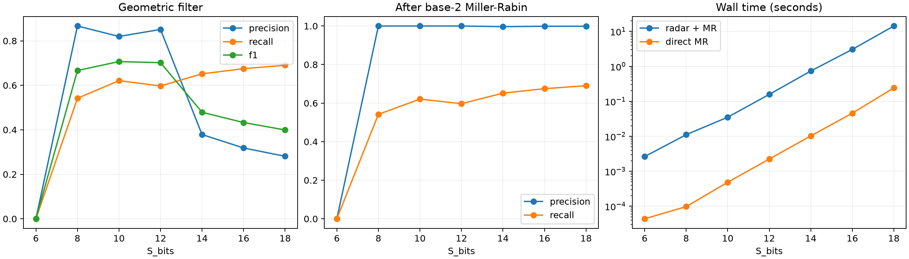

# OMEGAGRAD

[Read in English](../../README.md) · [Acervo em português](ARCHIVE.md)

**A Differentiable Top-Down Framework for Cosmological Finite Arithmetic**

**Richard Ikeda — Autor e pesquisador principal**
Versão 1.0.0 · Edição final de arquivo · 6 de novembro de 2026 · Licença MIT

OMEGAGRAD é um estudo de matemática experimental e computação científica sobre conjuntos finitos de primos representados por potenciais diferenciáveis. O horizonte é normalizado em um para comparar poços, barreiras, bacias de atração e detectores harmônicos de candidatos entre escalas. O corte operacional é o maior primo até 2**S_bits. A motivação cosmológica é conceitual.

| Fase | Escopo | Observação principal |
|---|---|---|
| 1 | 6–12 bits, autograd escalar e geometria do potencial | A suavização fixa perdeu poços. A suavização proporcional a P_omega⁻² preservou um poço por primo nas configurações testadas. |
| 2 | 6–12 bits, fundo contínuo, onda de base reduzida e remoção de primos | O erro absoluto médio diminuiu após subtração do fundo, mas o R² de teste com duas variáveis permaneceu negativo. A onda teve recall alto e muitos falsos positivos. |
| 3 | Radar até 18 bits, geometria até 16 bits e derivadas tensoriais | A regressão retrospectiva com três variáveis atingiu R² de 0,1841 em 16 bits. O filtro elevou a precisão com perda de recall, e o híbrido foi mais lento que Miller–Rabin base 2 direto. |



Em 12 bits, a suavização fixa deixou 74 mínimos para 564 primos, enquanto a escalada preservou 564 mínimos. Entre as Fases 2 e 3, os falsos positivos passaram de 2.211 para 57, com recall final de 59,71%. Essa comparação reúne mudanças na base, na restrição de fase e nos limiares. A regressão usa um potencial que contém os primos-alvo. A avaliação do radar de base reduzida é separada, e Miller–Rabin com uma única base pode aceitar pseudoprimos.

## Instalar e reproduzir

Use Python 3.10 ou posterior. As execuções de referência usaram Python 3.12. Crie e ative um ambiente virtual na raiz do repositório.

```bash
python -m pip install -e ".[test,report]"
python -m pytest -q
python -m examples.scalar_optimization
python -m examples.tensor_derivatives
python -m examples.background_subtraction
python -m examples.stationary_landscape
```

Os dados publicados já estão no repositório. Use uma cópia separada para reproduzir as Fases 2 e 3, pois os comandos escrevem nos diretórios de referência. O guia de reprodução lista os comandos, os commits das campanhas e as diferenças de ambiente.

## Reutilizar os componentes

```python
from omegagrad.engine import Value
x = Value(2.0)
loss = (x - 3.0)**2
loss.backward()
print(x.grad)  # -2.0
```

Value calcula derivadas escalares de primeira ordem em modo reverso. TensorValue oferece broadcasting, gradientes reversos e segundas derivadas direcionais. Para coordenadas independentes, essas segundas derivadas dão a curvatura local.

- [Artigo técnico](ARTIGO_TECNICO.md) · [PDF em português](../../output/pdf/OMEGAGRAD_Artigo_Tecnico.pdf)
- [Teoria](THEORY.md) · [Metodologia](METHODOLOGY.md) · [Conclusões](INITIAL_FINDINGS.md)
- [Reprodução](REPRODUCIBILITY.md) · [Dicionário dos dados](DATA_DICTIONARY.md) · [Reutilização](REUSE_GUIDE.md)
- [Dados da Fase 1](../../outputs/first_run/results.json) · [Fase 2](../../outputs/phase2/results.json) · [Fase 3](../../outputs/phase3/results.json)
- [Citação](../../CITATION.cff) · [Licença](../../LICENSE) · [Contribuição](CONTRIBUTING.md)
